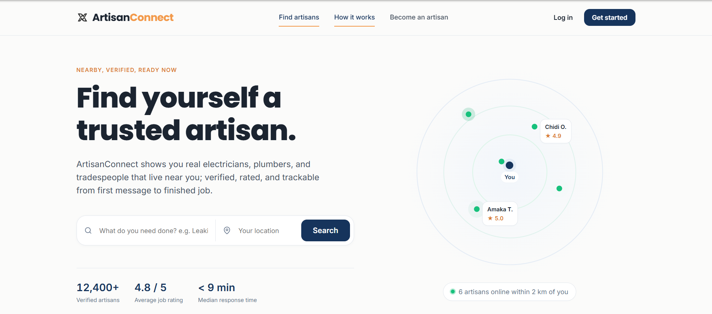
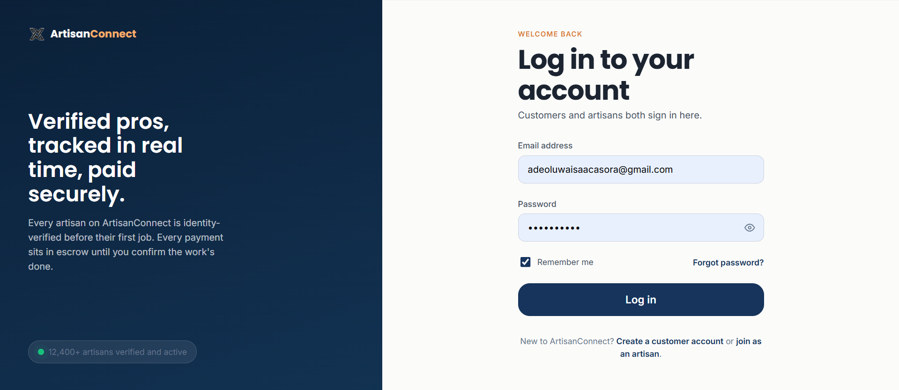
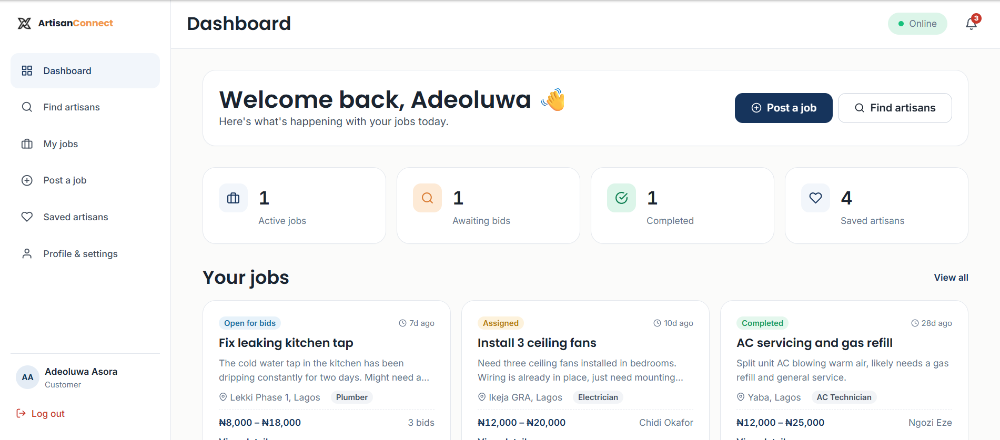
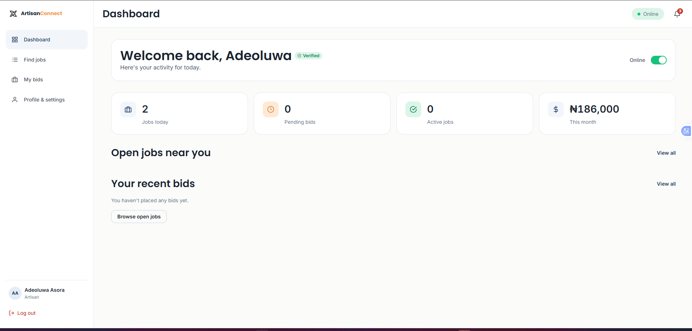

# ArtisanConnect

An AI-powered artisan discovery, negotiation, and secure payment marketplace connecting customers with verified local tradespeople — electricians, plumbers, carpenters, and more.

## Screenshots

### Landing Page

### Login

### Customer Dashboard

### Artisan Dashboard

### Find Nearby Artisans

### Post a Job

### Real-Time Chat

## Tech Stack

**Frontend:** React 19, TypeScript, Vite, React Router, TanStack Query, Axios, React Hook Form, Zod, CSS Modules

**Backend:** ASP.NET Core 9, PostgreSQL (PostGIS), Redis, JWT authentication

**Infrastructure:** Docker, Docker Compose, nginx

## Getting Started

\`\`\`bash
docker compose up --build
\`\`\`

Then open http://localhost:3000

## Project Structure

- \`artisanconnect_frontend/\` — React frontend
- \`src/\` — .NET backend (Core, Application, Infrastructure, API)
- \`docker-compose.yml\` — full stack orchestration